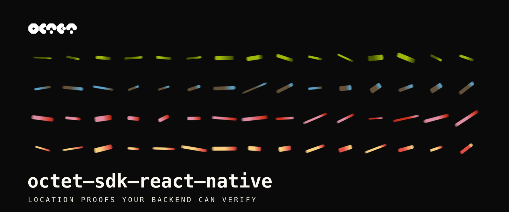

<p align="center">
  <a href="https://octetproof.com">
    
  </a>
</p>

<div align="center">

**Ask where a phone is from React Native, and get a signed proof your backend can verify.**

[](https://github.com/octetproof/octet-sdk-react-native/releases) [](https://www.npmjs.com/package/@octetproof/react-native) [](#install) [](https://octetproof.com/docs/mobile/getting-started/react-native/) [](https://github.com/octetproof/octet-sdk-react-native/blob/main/LICENSE) [](https://github.com/octetproof/octet-sdk-react-native)

[](https://octetproof.com) [](https://octetproof.com/docs/mobile/getting-started/react-native/) [](https://verifier.octetproof.com/)

</div>

> [!IMPORTANT]
> **Octet proves; you decide.** This package proves where the device is and returns the
> answer with a signed proof. It does not block, allow or change anything in your app or
> on your servers. Your backend verifies the proof and decides what happens to the
> request. If your backend ignores the answer, nothing is enforced.

## What it is

Many apps have to know where a user is before they allow something: a payment from a
sanctioned country, a game in a jurisdiction where it isn't licensed, content outside
its rights region. A GPS reading or an IP address is easy to fake, and a yes/no that
your app reports is only as trustworthy as the device it runs on.

`@octetproof/react-native` binds the Octet iOS and Android SDKs. It answers a location
question, such as *"Is the device in the US?"*, with **YES**, **NO** or
**INDETERMINATE**, backed by evidence instead of a claim:

- **A signed location proof.** Every YES or NO carries a proof signed by a device key
  that the native SDK creates in the device's secure hardware where it can (the Secure
  Enclave on iOS, StrongBox or the Trusted Execution Environment on Android). Each
  proof reports the key's storage tier.
- **An attested install.** The SDK activates with Apple App Attest on iOS and hardware
  key attestation on Android. There is no licence key to ship.
- **Spoofing checks on the device.** A suspected spoofed location or a tampered device
  returns INDETERMINATE with a reason code and no proof.
- **Fail-closed.** When the SDK can't answer, for example before the first location
  fix, the answer is INDETERMINATE with a reason code and no proof, never a guess.
- **A region, not a trace.** A country question gets a proof that names the country.
  Your backend receives that proof, not the device's GPS history.
- **One call.** `sdk.loc.isWithin(region)` asks the question and returns the answer
  with its proof. The verdict type only exposes a proof after you check the answer.

## Install

```bash
npm install @octetproof/react-native
```

**Expo.** Add the config plugin to `app.json` and run `npx expo prebuild`. It sets the
`Info.plist` permission strings, the iOS deployment target, Octet's Maven repository and
`minSdkVersion`:

```json
{ "expo": { "plugins": ["@octetproof/react-native"] } }
```

**Bare React Native.** Set the iOS deployment target to 16.0 in `ios/Podfile` and run
`pod install`. Set `minSdkVersion` to 30 and add Octet's Maven repository to your app's
Android build. Both platforms also need the location and motion permission strings.
Each step, and the error you see when one is missing, is in
[`INTEGRATION.md`](https://github.com/octetproof/octet-sdk-react-native/blob/main/INTEGRATION.md#ios).

Requires React Native 0.71 or later (both architectures), iOS 16 and Android API 30. A
physical device is needed: attestation doesn't run on the iOS Simulator, and the
Android SDK ships for `arm64-v8a` only, so the standard emulator can't run it.

## Quick start

Register your app with Octet at [octetproof.com](https://octetproof.com), and request
location permission before you start the SDK.

```ts
import { Octet, OctetRegion } from '@octetproof/react-native';

// 1. Start the SDK. It activates by attesting the app, so there's no licence key.
const sdk = await Octet.start();

// 2. Ask one question. The answer is 'YES', 'NO' or 'INDETERMINATE'.
const verdict = await sdk.loc.isWithin(OctetRegion.country('US'));

// 3. Send the proof to your backend. It verifies the proof and decides.
if (verdict.result !== 'INDETERMINATE') {
  await myBackend.submit({ proof: verdict.proof.proof_bytes_b64 });
}
```

`OctetVerdict` is a discriminated union: `verdict.proof` compiles only after you rule
out `'INDETERMINATE'`. Predicates return a verdict for every SDK outcome. `Octet.start`
rejects with a `LicenseError` when activation fails. `myBackend` stands for your own
API.

> [!TIP]
> A demo app is in
> [`sample/`](https://github.com/octetproof/octet-sdk-react-native/tree/main/sample).
> [`INTEGRATION.md`](https://github.com/octetproof/octet-sdk-react-native/blob/main/INTEGRATION.md)
> has the setup, the full API, regions, options, errors and proof handling.

## How it works

```text
  1. your app                    2. your backend                   3. you
 ┌─────────────────────┐ proof  ┌─────────────────────────┐       ┌────────────────┐
 │ the native SDK      │ ─────► │ verifies the proof,     │ ────► │ decide: allow, │
 │ proves where the    │        │ offline, with           │       │ step up, block │
 │ device is, signs it │        │ octet-verify            │       │ …              │
 └─────────────────────┘        └─────────────────────────┘       └────────────────┘
```

The JavaScript side only asks the question and carries the answer. The native SDK
builds and signs the proof on the device, and `proof_bytes_b64` holds it as base64.
The proof carries what is needed to check its signatures, so your backend can verify it
with the open-source [`octet-verify`](https://github.com/octetproof/octet-verify)
without calling Octet.

## Reading the answer

| Answer | When | In the verdict | What your backend might do |
|---|---|---|---|
| **YES** | The device is inside the region you asked about. | `result === 'YES'`, `proof` is set | Your rule for YES: allow, or block, depending on the question |
| **NO** | The device is outside that region. | `result === 'NO'`, `proof` is set | Your rule for NO |
| **INDETERMINATE** | The SDK can't answer right now, or it detected spoofing or tampering. | `proof` is `null`, `reason` says why, for example `NO_FIX` or `SPOOFING_DETECTED` | Ask again, step up, or refuse. Don't read it as NO. |

`result` is a non-empty string in all three cases, so `if (verdict.result)` is always
true. Compare it explicitly: `verdict.result === 'YES'`. When the reason is
`INSUFFICIENT_PRECISION`, `achievable_level` names the best level the SDK can prove
right now. See
[Reading a verdict](https://github.com/octetproof/octet-sdk-react-native/blob/main/INTEGRATION.md#reading-a-verdict)
and the [verdicts guide](https://octetproof.com/docs/mobile/concepts/verdicts/).

> [!WARNING]
> **Verify the proof on your server, not the result in the app.** The app's copy of
> `result` is only as trustworthy as the device. Your backend checks
> `proof_bytes_b64` with `octet-verify` and reads the answer from the signed proof.
> `proof_bytes_b64` is non-enumerable, so a spread or `JSON.stringify` of the verdict
> leaves it out: name the field when you send it. See
> [Proof handling](https://github.com/octetproof/octet-sdk-react-native/blob/main/INTEGRATION.md#proof-handling)
> and [Verifying proofs](https://octetproof.com/docs/mobile/concepts/verifying-proofs/).

## Verifying the download

The npm package is published with [npm provenance](https://docs.npmjs.com/generating-provenance-statements),
so `npm audit signatures` checks its registry signature and provenance. During
`pod install` the native iOS framework is downloaded and checked against a pinned
checksum, and a mismatch fails the install. Each release on GitHub also attaches the
package tarball, `SHASUMS256.txt`, its keyless [Sigstore](https://www.sigstore.dev/)
signature (`SHASUMS256.txt.sig` and `SHASUMS256.txt.pem`) and a CycloneDX SBOM. The
commands are in
[`INTEGRATION.md`](https://github.com/octetproof/octet-sdk-react-native/blob/main/INTEGRATION.md#verifying-your-octetsdk-download).

## Sample app

A one-screen Expo demo is in
[`sample/`](https://github.com/octetproof/octet-sdk-react-native/tree/main/sample). It
activates the SDK, asks whether the device is in a region and shows the verdict. See
its [README](https://github.com/octetproof/octet-sdk-react-native/blob/main/sample/README.md)
to run it on a device.

## Documentation

- [Mobile SDK docs](https://octetproof.com/docs/mobile/): concepts, the
  [React Native guide](https://octetproof.com/docs/mobile/getting-started/react-native/)
  and the API reference.
- [`INTEGRATION.md`](https://github.com/octetproof/octet-sdk-react-native/blob/main/INTEGRATION.md):
  setup, the API, [regions](https://github.com/octetproof/octet-sdk-react-native/blob/main/INTEGRATION.md#regions),
  [predicate options](https://github.com/octetproof/octet-sdk-react-native/blob/main/INTEGRATION.md#predicate-options),
  [committed content and uploads](https://github.com/octetproof/octet-sdk-react-native/blob/main/INTEGRATION.md#committed-content-and-uploads),
  [errors](https://github.com/octetproof/octet-sdk-react-native/blob/main/INTEGRATION.md#errors),
  [what this library does not expose](https://github.com/octetproof/octet-sdk-react-native/blob/main/INTEGRATION.md#what-this-library-does-not-expose)
  and [versions](https://github.com/octetproof/octet-sdk-react-native/blob/main/INTEGRATION.md#versions).
- [`CHANGELOG.md`](https://github.com/octetproof/octet-sdk-react-native/blob/main/CHANGELOG.md):
  changes that affect your integration.
- [octet-sdk-ios](https://github.com/octetproof/octet-sdk-ios) and
  [octet-sdk-android](https://github.com/octetproof/octet-sdk-android): the native SDKs
  this package binds.
- [octet-verify](https://github.com/octetproof/octet-verify): the open-source verifier
  for your backend.

## About this repository

This repository holds the documentation of the `@octetproof/react-native` npm package,
the release files (under Releases), a sample app and the workflow that publishes the
package to npm. The package has
its own version and pins one native SDK version, the same on iOS and Android. Each
release is one commit, tagged with its version. Bug reports and questions are welcome
as issues.

## Security

Report a vulnerability privately to security@octetproof.com, not in an issue. See
[SECURITY.md](https://github.com/octetproof/octet-sdk-react-native/blob/main/SECURITY.md).

## License

See [LICENSE](https://github.com/octetproof/octet-sdk-react-native/blob/main/LICENSE).
